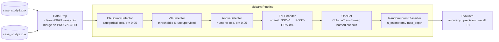
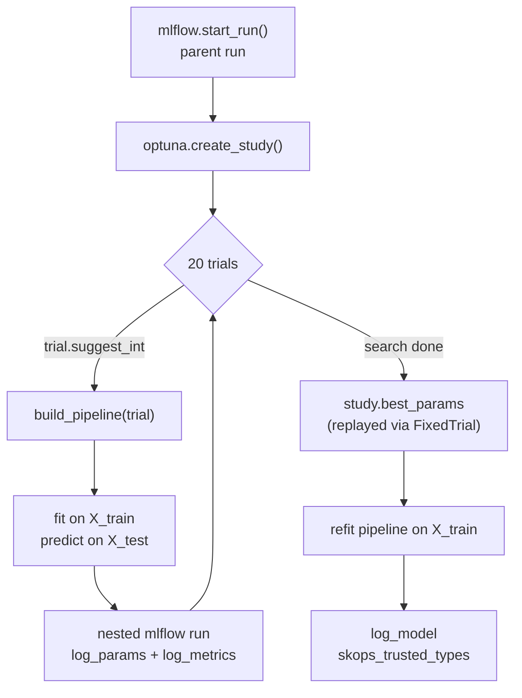

# Credit Risk MLOps Pipeline

A multi-class (4-tier) credit risk classifier built from raw bureau data, with a strong
emphasis on something most tutorials skip: **catching the ways a model lies to you**
before it ever reaches production. The project started as an exploratory notebook,
found a textbook case of target leakage, and was rebuilt into a modular, leakage-aware
`sklearn.Pipeline` with Optuna hyperparameter search and full MLflow experiment tracking.

## The headline finding

The first version of this model scored **99.04% accuracy**. That's not a win — it's a
red flag. One feature, `Credit_Score`, carried ~50% of the model's feature importance
and almost perfectly determined the target (`Approved_Flag`): applicants scoring
707–741 were 100% class `P1`; scoring 571–639 were 100% class `P4`. The target had
clearly been *derived from* that feature at some point upstream, so the model wasn't
learning credit risk — it was just reverse-engineering a lookup table.

| | With `Credit_Score` | Without `Credit_Score` |
|---|---|---|
| Accuracy | 98.9% | **76.3%** |
| What it means | Leaking the answer | Honest generalization |

Every design decision below — splitting feature selection into `fit`/`transform` steps,
scoping statistics to training data only, tracking every run in MLflow — exists because
of lessons learned chasing leakage like this.

## Pipeline architecture

Data cleaning and merging happen once, outside any pipeline (they drop rows, which a
fitted pipeline step must never do). Everything downstream of that — feature selection,
encoding, modeling — is one `sklearn.Pipeline`, so every statistic is learned from
`X_train` only and replayed consistently onto `X_test`.



### Feature selection methodology

| Step | Test | Scope | Keep rule |
|---|---|---|---|
| `ChiSquareSelector` | Chi-square | Categorical features vs. target | drop if p > 0.05 |
| `VIFSelector` | Variance Inflation Factor | Numeric features, unsupervised | sequential drop of worst offender until all VIF ≤ 6 |
| `AnovaSelector` | One-way ANOVA (`f_oneway`) | Numeric features vs. target, runs after VIF | drop if p > 0.05 |

`VIFSelector` and `AnovaSelector` are deliberately separate classes rather than one
combined step — VIF never looks at the target (`fit(X, y=None)`), ANOVA requires it
(`fit(X, y)`). Forcing them into one class would mean a signature that lies about what
it needs.

## Hyperparameter tuning + experiment tracking

Optuna drives the search, MLflow records every trial as a nested run under one parent
study — so the full search is visible and comparable afterward, not just the winner.



Each trial's precision/recall/F1 (not just the optimized accuracy) is stashed via
`trial.set_user_attr(...)` and pulled back off the winning trial afterward, so the
best run's full metric picture gets logged, not just the one value Optuna optimized.

### How the best model actually gets picked

1. Each of the 20 trials builds a fresh pipeline with Optuna-suggested `n_estimators`/
   `max_depth`, fits it on `X_train`, and logs its own metrics as a nested MLflow run.
2. Optuna's sampler tracks every trial's returned accuracy and keeps narrowing in on
   the region of the search space that scores highest — `study.best_params` is just
   whichever trial scored the single highest `accuracy` out of the 20.
3. That winning parameter set is replayed through `build_pipeline(...)` via
   `optuna.trial.FixedTrial(study.best_params)` — a full pipeline is rebuilt and
   **refit from scratch** (no trial's in-memory model is reused), then logged as the
   final `model` artifact on the parent run.

**Result from the run tracked in this repo's experiment** (`Credit card analysis`,
parent run `optuna_study_on_credit_card`, 20/20 trials finished):

| Metric | Best trial value |
|---|---|
| `n_estimators` | 197 |
| `max_depth` | 10 |
| Accuracy | **75.18%** |
| Precision (weighted) | 72.73% |
| Recall (weighted) | 75.18% |
| F1 (weighted) | 70.46% |

That's the leakage-free, Optuna-tuned result — view the full comparison across all 20
trials (and against the un-tuned baseline) in the MLflow UI at `127.0.0.1:5000`.

## Project structure

```
credit-risk-mlops-pipeline/
├── README.md
├── requirements.txt
├── case_study1.xlsx             # raw bureau data (trade line summary)
├── case_study2.xlsx             # raw bureau data (enquiry/behavioral detail)
├── PROJECT_SUMMARY.txt          # narrative history: leakage diagnosis, design decisions
├── notebooks/
│   ├── main_file.ipynb          # original exploration — the leakage investigation
│   └── main_2.ipynb             # intermediate refactor, pre-src/ split
└── src/
    ├── data_prep.py             # load_raw_data, clean_mostly_null_cols/rows, find_merge_cols
    ├── transformers.py          # ChiSquareSelector, VIFSelector, AnovaSelector, EduEncoder,
    │                             # build_onehot_step — all fit/transform, sklearn-compatible
    └── train.py                 # orchestration entrypoint: data → Pipeline → Optuna → MLflow
```

## Running it

```bash
pip install -r requirements.txt

# terminal 1 — tracking server
mlflow server --host 127.0.0.1 --port 5000

# terminal 2 — training + hyperparameter search
python -m src.train
python -m src.train --drop_credit_score   # leakage comparison run
```

Then open `http://127.0.0.1:5000` to compare runs — accuracy, precision, recall, F1,
and the full Optuna trial history, side by side.

## Stack

- **scikit-learn** — custom `BaseEstimator`/`TransformerMixin` classes chained into one `Pipeline`
- **Optuna** — hyperparameter search, nested-run-tracked
- **MLflow** — experiment tracking, model registry-ready logging (signature, `skops` safe serialization)
- **pandas / scipy / statsmodels** — chi-square, VIF, ANOVA feature selection
